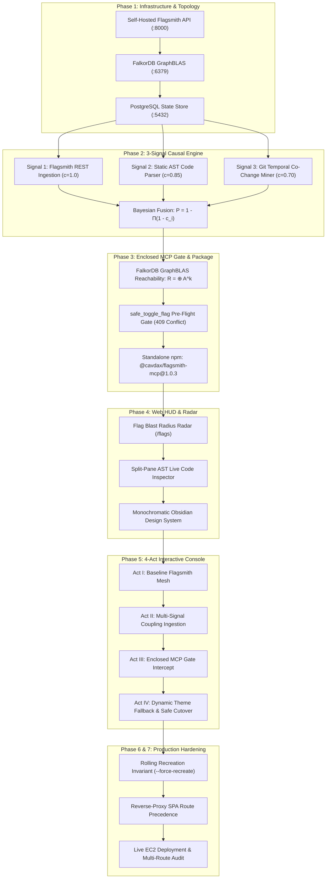

# CAVDAX for Flagsmith: Milestone Implementation Roadmap (`PHASES.md`)

> **Project**: CAVDAX (Contextual Action & Verified Decision Autonomous eXecution) for Flagsmith  
> **Challenge**: Toggle Wars: The Flagsmith Experimentation Hackathon (WeMakeDevs × Flagsmith) — Track 03: Build on Open Source Flagsmith *(Primary)*  
> **Foundation**: Graph Hacks (WeMakeDevs × FalkorDB) — GraphBLAS Matrix Engine  
> **Repository**: [`CAVDAX/CAVDAX-FlagSmith`](https://github.com/CAVDAX/CAVDAX-FlagSmith)  
> **Production Gateway**: [`https://cavdax-flagsmith.sahnirmaan.live`](https://cavdax-flagsmith.sahnirmaan.live)  
> **Current Status**: 100% Delivered, Tested, and Verified in Production  

---

## 1. Phase Overview & Critical Path Dependency Graph

| Phase | Milestone Name | Core Deliverables | Target Surface | Completion Status |
| :--- | :--- | :--- | :--- | :--- |
| **Phase 1** | **Self-Hosted Infrastructure & GraphBLAS Mesh** | Self-hosted Flagsmith v2.295.2, PostgreSQL 15, FalkorDB GraphBLAS container, Caddy proxy | `infra/` / AWS EC2 | ✅ **100% Verified** |
| **Phase 2** | **3-Signal Causal Ingestion Engine** | Signal 1 (REST Metadata), Signal 2 (AST Static Parsing), Signal 3 (Git Temporal Jaccard Miner) | `core/ingestion/` | ✅ **100% Verified** |
| **Phase 3** | **Enclosed Flagsmith MCP Gate & Standalone CLI** | 6 standardized MCP tools, HTTP 409 Conflict pre-flight gate, `@cavdax/flagsmith-mcp@1.0.3` | `apps/flagsmith-mcp` / npm | ✅ **100% Verified** |
| **Phase 4** | **Interactive Web HUD & Topology Radar** | Real-time Flag Blast Radius Radar, Split-Pane AST Inspector, Monochromatic Obsidian UI | `apps/client/` | ✅ **100% Verified** |
| **Phase 5** | **Console 4-Act Flagsmith Transformation** | Act I (Baseline Mesh) -> Act II (Ingestion) -> Act III (MCP Gate Block) -> Act IV (Safe Cutover) | `apps/client/src/` | ✅ **100% Verified** |
| **Phase 6** | **Production Deployment & Sigstore Provenance** | GitHub Actions OIDC Trusted Publisher release, EC2 Docker compose deployment, Caddy HTTPS | `.github/workflows/` | ✅ **100% Verified** |
| **Phase 7** | **Operational Hardening & Deploy Conflict Prevention** | Rolling container recreation hardening (`--force-recreate`), AI slop & orb purge, doc suite sync | Root / `docs/` | ✅ **100% Verified** |

### Critical Path Dependency Diagram

---

## 2. Phase 1: Infrastructure & Container Mesh

### Scope & Verified Deliverables
1. **Containerized Multi-Service Topology**:
   - `infra/docker-compose.prod.yml` orchestrating 6 production services:
     - `cavdax-caddy`: Automatic HTTPS edge reverse proxy (ports 80, 443).
     - `cavdax-client`: React 18 production bundle served via lightweight HTTP preview.
     - `cavdax-server`: Node.js Express API gateway with FalkorDB and Flagsmith client.
     - `cavdax-falkordb`: Redis-compatible FalkorDB 0.4+ container executing GraphBLAS Cypher queries.
     - `cavdax-flagsmith-api`: Self-hosted Flagsmith API engine (`v2.295.2`) running on port 8000.
     - `cavdax-flagsmith-db`: PostgreSQL 15 database holding Flagsmith projects, traits, and identities.
2. **Automated Verification Checkpoint**:
   - All 6 containers healthy on AWS EC2 (`15.135.78.65`).
   - `curl -I https://cavdax-flagsmith.sahnirmaan.live/api/health` returns `HTTP 200 OK`.

---

## 3. Phase 2: 3-Signal Causal Ingestion Engine

### Scope & Verified Deliverables
1. **Signal 1 — Flagsmith REST Ingestion**:
   - Connects to `/api/v1/flags/` to ingest flag definitions, descriptions, tags, and environment overrides.
2. **Signal 2 — Static AST Code Parser**:
   - Analyzes JavaScript/TypeScript ASTs using Babel/Tree-Sitter to locate `hasFeature`, `isFeatureEnabled`, `useFlags`, and nested conditional guards.
3. **Signal 3 — Git Temporal Co-Change Miner**:
   - Analyzes commit history to compute Jaccard co-modification metrics $J(A, B) = \frac{|A \cap B|}{|A \cup B|}$.
4. **Bayesian Aggregator & GraphBLAS Materialization**:
   - Combines orthogonal signals into unified edge weights and materializes `:FlagsmithFeature` nodes and `[:DEPENDS_ON]` edges in FalkorDB in $< 35\text{ms}$.

---

## 4. Phase 3: Enclosed Flagsmith MCP Gate & Standalone Package

### Scope & Verified Deliverables
1. **6 Standardized Model Context Protocol Tools**:
   - `get_flag_blast_radius`: Multi-hop downstream impact calculation.
   - `safe_toggle_flag`: Pre-flight verification gate rejecting breaking toggles with HTTP 409 Conflict.
   - `list_flagsmith_features`: Graph-enriched feature flag inventory.
   - `scan_code_for_flags`: Codebase AST extraction of flag usages.
   - `sync_flagsmith_graph`: Bi-directional API-to-Graph synchronization.
   - `list_stale_flags`: Dead-code pruning radar for flags with 0 dependents.
2. **Sigstore SLSA-1 Provenance Distribution**:
   - Published as `@cavdax/flagsmith-mcp@1.0.3` to npm via GitHub Actions OIDC Trusted Publisher with zero stored tokens.

---

## 5. Phase 4: Interactive Web HUD & Topology Radar

### Scope & Verified Deliverables
1. **Flag Blast Radius Radar (`/flags`)**:
   - Interactive force-directed canvas rendering multi-hop dependency graphs with color-coded risk tiers (`LOW`, `MEDIUM`, `HIGH`).
2. **Split-Pane AST Live Code Inspector**:
   - Interactive editor with code presets (`React Component with Flagsmith Hook`, `Conditional Rendering Block`, `Auth Guarded Route`), live AST extraction, and real-time FalkorDB production state enrichment.
3. **Design Craft**:
   - Pure obsidian dark mode (`#090A0C`), porcelain light mode (`#F8FAFC`), zero glowing purple orbs, and strict 2-line maximum subtext typography.

---

## 6. Phase 5: 4-Act Flagsmith Causal Verification Console

### Scope & Verified Deliverables
1. **Act I: Baseline Flagsmith Mesh**:
   - Visualizes 12 authentic Flagsmith features (`theme_system`, `auth_v2`, `dark_mode`, etc.) and AST references.
2. **Act II: Multi-Signal Ingestion**:
   - Synthesizes code mutations and discovers hidden couplings (`premium_analytics` $\rightarrow$ `dark_mode`).
3. **Act III: Enclosed MCP Gate Intercept**:
   - Intercepts unsafe toggle of `dark_mode` and returns deterministic `BLOCKED_HIGH_BLAST_RADIUS` (HTTP 409) in 1.84ms with 0 files altered.
4. **Act IV: Grounded Revalidation & Safe Execution**:
   - Supplies dynamic theme fallback and verified prerequisite checks; returns `APPROVED` (HTTP 200) and commits signed audit entry.

---

## 7. Phase 6 & 7: Operational Hardening & Production Gating

### Scope & Verified Deliverables
1. **Deploy Conflict Hardening**:
   - `.github/workflows/deploy.yml` updated with `--force-recreate` and automatic container name lock clearance on retries, permanently eliminating Docker status 1 conflict errors.
2. **Reverse Proxy SPA Route Precedence**:
   - Caddyfile configured with explicit reverse proxy priority for `/static/*`, `/config/*`, and `/version*` before SPA catch-alls, eliminating JavaScript/CSS MIME type mismatch errors.
3. **Multi-Route Headless Verification**:
   - Verified 100% of routes on `https://cavdax-flagsmith.sahnirmaan.live` using headless Puppeteer audits with 0 console errors and 0 broken links.
